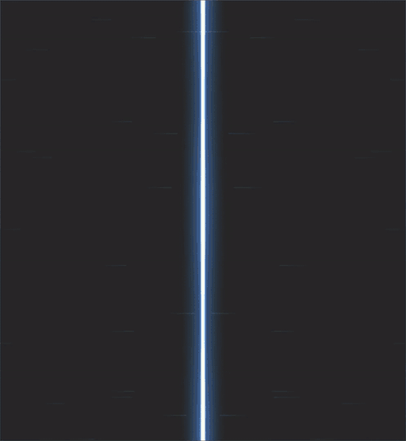

# Theseus

A desktop session sphere for your Claude Code sessions, for Windows. You can talk to it.

[](https://buymeacoffee.com/fullcircle_0)



*Demo sessions with made-up names. The sphere has six modes, spreads into the tile view, and two tiles are
replaced by fresh sessions.*

**Unofficial.** Theseus is not made, endorsed or supported by Anthropic. It reads the session files Claude Code writes on
your PC. When you turn on App control, it can also press buttons in the Claude desktop app for you.

## What it does

### The sphere
- Shows your recent Claude Code sessions as tiles on a turning sphere on the desktop. They are read from
  `~/.claude/projects` on your PC, and nothing is uploaded.
- Each tile shows how the session is doing:
  - **Working** pulses softly in the core colour.
  - **Waiting on you** (a question, a plan or a permission request) pulses yellow.
  - **Idle** dims a little.
- A tile ages as its context fills (**wear**: ember, rust, scorch and more). It heats up as it nears its swap line.
- When a session is replaced by a fresh one, the old tile breaks up and the new one takes its seat (**swap** effects:
  flare, shatter, dissolve and more).
- **Tile view.** Hover the sphere, or say "tile view", and the tiles spread out into rows: Session manager, Active,
  Ungrouped, Parked and Archived. You choose which groups show on the sphere and in the rows.
- **Modes:** Normal, Worker, Night, Weekend, Max perf and Max efficiency. Each mode gives the core its own colour and
  motion. Worker spins faster, Night slows down, and Max perf throws spikes. The current mode is read from a Modes folder
  that you set under Paths.
- **Backgrounds** behind the sphere: black, space, moving space, a flowing gradient, or space travel. Can be shown as a
  live wallpaper.

### Sessions
- Click a tile to read the session in a console card on the desktop, or open it in the Claude app (**Open in Claude**).
- Projects, Artifacts and Routines views.
- Search the text of all your sessions.

### Voice
- The assistant's name is its wake word. The default name is Theseus, and you can change it in Setup.
- Speak with push-to-talk (hold Right Ctrl), with the wake word, or always on.
- **Voice chat:** after the wake word, carry on talking. Once Theseus has replied it keeps listening for a few seconds
  (Chat wait, 3–30 s), no wake word needed. "That's all" or silence ends the chat.
- **Commands:**
  - Open a session ("open hand solver"), tile view, change modes.
  - "Tell <session> …" sends a message. It is read back first and sent after 3 s unless you say "cancel".
  - "What did <session> say", and "stop <session>".
  - Card control: "next tile", "scroll down", "close the card".
  - Dictation into the open card: "type …", "send it", "clear it".
  - "Change voice", "speak faster", "turn alerts off". "Undo that" reverses the last change.
- **Quick answers** come from your session list, without a Claude call: "what is <session> doing", "who needs me",
  "how full is <session>".
- **Ask:** any other question goes to Claude Code, which can look through your sessions to answer it.
  - It can act for you: open, start, message, answer or stop sessions.
  - Anything that sends, starts, answers or stops is read back first.
- **Spoken alerts** when a session finishes, needs you or asks permission. "Stop talking" cuts the voice off.
- Uses a built-in Windows voice. A Kokoro voice folder and Whisper (for better recognition) are optional.

### Tools for your sessions (MCP)
Theseus can add an MCP server named `theseus` to Claude Code (**Add** under Theseus settings). With it, your sessions can:
- list and read each other;
- search all conversations;
- speak or show a caption;
- flag that they need you;
- message another session;
- record the screen until a session goes idle.

You choose what they may do, and you can turn the tools off.

### Other tools
- **Recorder:** screen recording, screenshots and a replay buffer, saved to your recordings folder. This needs ffmpeg.
  The keys are Ctrl+Alt+R (record / stop), Ctrl+Alt+P (screenshot) and Ctrl+Alt+F12 (save replay).
- Repository tools for a working folder: worktrees, git status and MCP servers.

## Privacy
Theseus reads Claude Code's session files on your PC (`~/.claude/projects`) and keeps its settings in `%APPDATA%`. It has
no account, no telemetry and no server: nothing is uploaded by Theseus itself. Questions you send to Ask go to Claude
through your own Claude Code. Speech recognition (Windows or Whisper) runs on your PC. Opening a session in the Claude app
uses the app's own `claude://` link.

## Requirements
- Windows 10 or 11.
- Claude Code sessions on this PC: the Claude desktop app, or the `claude` CLI.
- Optional:
  - git and the GitHub CLI (`gh`), for the repository tools.
  - Windows Terminal.
  - ffmpeg on PATH, or set under Paths, for recording.
  - Python with Whisper, for voice questions.

## Install
1. Run `Theseus Setup x.y.z.exe`. The installer is unsigned, so Windows SmartScreen warns the first time. Choose
   **More info → Run anyway**.
2. The Setup card opens on first start. There you set:
   - the assistant name;
   - the recordings folder;
   - App control.

   The card also lists the tools it found. All of these can be changed later under General settings.
3. Start with Windows is a switch in General settings.

To uninstall, use Windows Settings → Apps → Theseus.

## App control (off by default)
When App control is on, you can do these things from the sphere or by voice: reply to a session, answer its questions,
and start, rename, fork, stop or archive sessions. It works by pressing buttons in the Claude app for you, the way a person
would.

Anthropic's terms restrict automated access to its services, so use App control at your own risk. It can also stop
working when the Claude app updates. While it is off, the console is read-only.

## Support
Theseus is free. If it saves you time or you enjoy this project, you can buy me a coffee: [buymeacoffee.com/fullcircle_0](https://buymeacoffee.com/fullcircle_0)

## License
MIT, see [LICENSE](LICENSE).

## Build from source
```
npm install
npm start          # run
npm run dist       # dist/Theseus Setup x.y.z.exe
```
